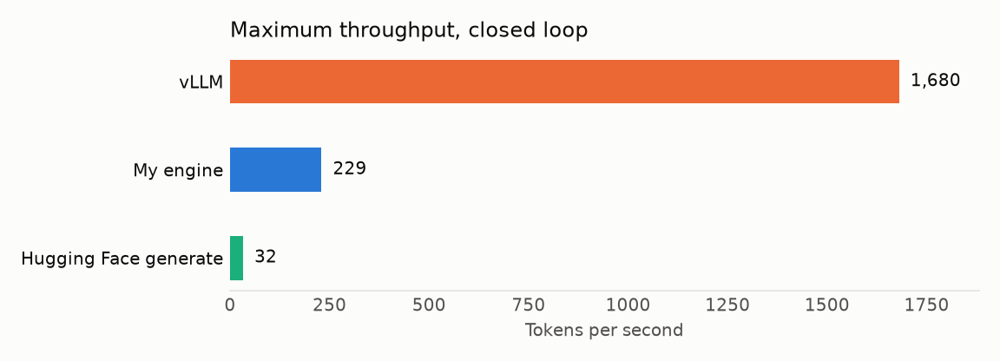
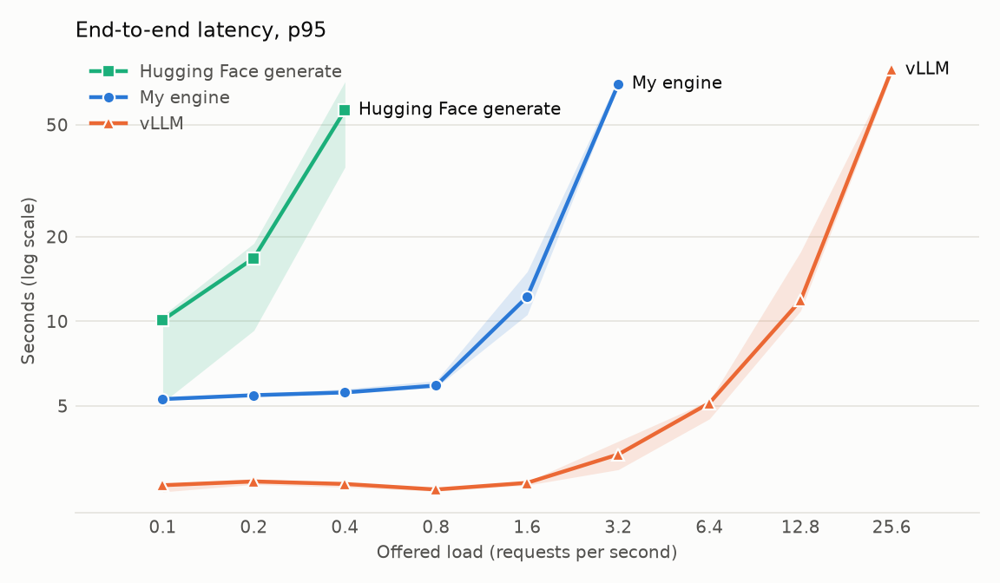
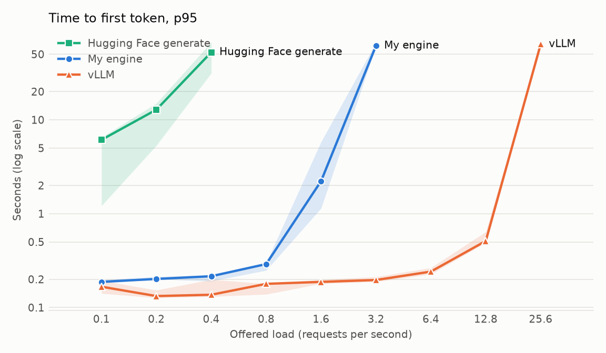
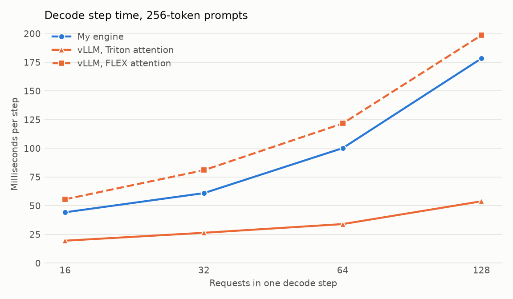

# llm-engine

**An LLM serving engine built from scratch in Python and PyTorch, measured against vLLM on a real
GPU.** It has its own Qwen2 model, key/value cache, continuous batching scheduler and
OpenAI-compatible streaming API.

Built by [MD Zahid Hasan](https://zahid-profile.vercel.app) to learn how LLM serving works from the
inside. It is a learning project, not a replacement for vLLM.

| | |
|---|---|
| **Result** | 229 tokens/s on one Tesla T4: 7 times Hugging Face `generate` run one request at a time (32), and 7 times below vLLM (1,680) |
| **Main finding** | The cost is not HTTP (3–5%). One long prompt sets the attention cost for every request in a pass, and vLLM's attention kernel keeps large batches cheap |
| **Evidence** | 3 repeats per point, raw per-request data saved for every run, 458 tests |



## What this project shows

| Skill | Where to see it |
|---|---|
| Transformer internals: rotary embeddings, grouped-query attention, KV cache | [engine/model.py](engine/model.py), [engine/cache.py](engine/cache.py) |
| Serving design: continuous batching, chunked prefill, admission control, cancellation | [engine/scheduler.py](engine/scheduler.py) |
| Concurrency: async API with one engine thread, streaming, disconnect handling | [engine/server.py](engine/server.py) |
| Benchmarking: open and closed loops, coordinated omission, saturation | [scripts/loadtest.py](scripts/loadtest.py), [benchmarks/](benchmarks/) |
| Performance analysis: finding a cause by removing one thing at a time | [Why it is slower than vLLM](#why-it-is-slower-than-vllm) |
| Honest reporting: what failed, what is limited, what is not proven | [Honest limits](#honest-limits) |

Three problems I found and fixed along the way:

- **NaN in float16.** Attention scores overflowed in half precision, so they are now computed in
  float32. A related trap: `0 * NaN` is still NaN, so the cache starts zeroed and is cleared on release.
- **A disconnect that nobody noticed.** Under a steady flow of events, a non-streaming client's
  disconnect was never checked. The check now runs on a timer.
- **Tests too weak to catch bugs.** I planted bugs on purpose to check the tests. Some survived, so
  I added exact tests on hand-made records.

**Contents:** [What it does](#what-it-does) · [Architecture](#architecture) ·
[Quick start](#quick-start) · [Results](#results) ·
[Why it is slower than vLLM](#why-it-is-slower-than-vllm) · [Honest limits](#honest-limits) ·
[Repository layout](#repository-layout) · [What comes next](#what-comes-next)

## What it does

- Its own Qwen2 model, loaded from Hugging Face weights, tested for matching logits.
- A preallocated key/value cache with a fixed number of slots. Each slot has its own length,
  position and mask, so prompts of different lengths share a forward pass with no padding.
- Continuous batching: a finished request leaves at once and a waiting one joins without stopping
  the others. Long prompts are prefilled in chunks, mixed with decode steps.
- A memory budget, admission control, a waiting-queue limit, cancellation that frees a slot at
  once, and failure isolation, so one bad request does not break the others.
- `POST /v1/chat/completions` with server-sent events, plus `/health` and `/metrics`. Partial
  characters are held back while streaming, and a client disconnect cancels its request.
- A load test tool that works against any OpenAI-compatible server, with Poisson and closed-loop
  arrivals. In Poisson mode latency starts at the scheduled arrival time, to avoid coordinated
  omission.

## Architecture

```
 clients
    |  HTTP, server-sent events
    v
 FastAPI (asyncio)              engine/server.py
    |  command queue   ^  one asyncio queue per request
    v                  |
 engine thread                  engine/server.py  (EngineLoop)
    v
 Scheduler                      engine/scheduler.py
    |  waiting -> prefilling -> decoding -> finished
    |  each step: admit, one chunk of prefill, one decode pass, sample, release
    v
 Qwen2 model  <->  KVCache      engine/model.py, engine/cache.py
    |              layers x slots x kv_heads x max_length x head_dim
    v
 Sampler, one per request       engine/sampling.py
```

Web requests never touch the model. They talk to one engine thread through queues, so a slow
client cannot block a step. The cache is taken in full at startup: with Qwen2.5-1.5B in float16
each token position costs 28,672 bytes, so 16 slots of 2,048 tokens hold about 0.94 GB. The budget
decides the number of slots, and "budget full" simply means every slot is busy.

Build notes for each step, with interview questions, are in
[docs/build-notes.md](docs/build-notes.md).

## Quick start

You need Python 3.11 or later. The tests need no GPU and download no model: they use a tiny random
model and take about a minute.

```bash
python -m venv .venv
```

```bash
.venv/bin/pip install -e ".[dev,server]"
```

```bash
.venv/bin/python -m pytest
```

The real model needs a CUDA GPU. Everything here was measured on a T4 with 15 GB of memory. Download
the model and start the server, using the folder the first command prints:

```bash
.venv/bin/python -c "from huggingface_hub import snapshot_download as d; print(d('Qwen/Qwen2.5-1.5B-Instruct'))"
```

```bash
.venv/bin/python -m engine.server --model-path <model folder> --model-name qwen --slots 16 --max-length 2048
```

Then send it a streaming request:

```bash
curl -N http://127.0.0.1:8000/v1/chat/completions -H 'Content-Type: application/json' -d '{"model": "qwen", "messages": [{"role": "user", "content": "Why is the sky blue?"}], "max_tokens": 40, "stream": true}'
```

Load test this server, or any other OpenAI-compatible one:

```bash
.venv/bin/python scripts/loadtest.py --base-url http://127.0.0.1:8000 --model qwen --prompts data/prompts.jsonl --mode poisson --rate 1 --duration 60 --output out.json
```

Repeat the benchmarks on a private Kaggle T4, which needs your own Kaggle token:

```bash
kaggle/push.sh benchmark
```

```bash
kaggle/push.sh gap
```

### Server options

| Option | Default | Meaning |
|---|---|---|
| `--model-path` | required | Folder with the checkpoint |
| `--model-name` | `local` | Name reported in responses |
| `--device` | `cuda` | Where the model runs |
| `--dtype` | `float16` | `float16`, `bfloat16` or `float32` |
| `--slots` | 8 | Requests that can run at once |
| `--max-length` | 4096 | Most tokens in one request, prompt included |
| `--prefill-tokens-per-step` | 256 | Prompt tokens processed between decode passes |
| `--max-waiting` | 1024 | Queue length before new requests are refused |
| `--cache-budget-mb` | none | Memory limit for the cache |
| `--host`, `--port` | `127.0.0.1`, 8000 | Where to listen |

`POST /v1/chat/completions` accepts `messages`, `max_tokens`, `temperature`, `top_p`, `top_k`,
`repetition_penalty`, `seed`, `stream`, `stream_options` and `ignore_eos`. It refuses `n` above 1,
`stop` strings, and presence or frequency penalties, rather than ignoring them.

## Results

**Hardware:** one Tesla T4 (15,360 MiB, driver 580.178.04) with 4 vCPUs (Intel Xeon 2.00 GHz) on a
private Kaggle kernel. The load generator shares those CPUs.

**Model:** `Qwen/Qwen2.5-1.5B-Instruct`, revision `989aa79`, **float16 on all three systems**.

**Settings, the same for all three:** 200 real prompts from Dolly 15k (median 49 tokens, longest
1,146), 128 output tokens with end-of-text ignored, greedy search, streaming, and the same seeds,
so each system saw identical traffic. Rates double from 0.1 requests per second until a system
saturates. Each point has at least 30 requests, or 90 seconds of arrivals, and is repeated 3 times.
Tables show the median of the repeats.

| System | Version | Setup |
|---|---|---|
| Hugging Face `generate` | transformers 5.22.1, torch 2.15.0 | One request at a time, default attention |
| My engine | torch 2.15.0 | 16 slots, 2,048 tokens per slot, 256 prefill tokens per step |
| vLLM | 0.32.0, torch 2.13.0 | Default settings, prefix cache **off**, 2,048 tokens maximum |

The prefix cache is off because the 200 prompts repeat, so it would measure repetition rather than
serving. A real vLLM deployment would normally leave it on. No system had a request error at any
point.

### Maximum throughput

| System | Closed loop, tokens/s (range) | Users | Overloaded, tokens/s | Highest rate kept up with |
|---|---|---|---|---|
| Hugging Face | 32 (32–32) | 2 | 32 at 0.4 req/s | 0.2 req/s |
| My engine | 229 (227–238) | 32 | 228 at 3.2 req/s | 1.6 req/s |
| vLLM | 1,680 (1,607–1,695) | 128 | 1,787 at 25.6 req/s | 12.8 req/s |

"Kept up with" means the system served at least 85% of the offered rate, with under 1% errors and
p95 under 120 seconds, on the majority of repeats.

### Latency against load

End-to-end p95 in seconds, then time to first token p95 in seconds. **Bold** marks a saturated
point, where the queue grows for as long as the test runs.

| Rate, req/s | Hugging Face | My engine | vLLM |
|---|---|---|---|
| 0.1 | 10.1 / 6.11 | 5.29 / 0.19 | 2.61 / 0.17 |
| 0.2 | 16.8 / 12.8 | 5.46 / 0.20 | 2.69 / 0.13 |
| 0.4 | **56.3 / 52.4** | 5.58 / 0.22 | 2.64 / 0.14 |
| 0.8 | | 5.91 / 0.29 | 2.52 / 0.18 |
| 1.6 | | 12.2 / 2.22 | 2.66 / 0.19 |
| 3.2 | | **69.7 / 61.4** | 3.36 / 0.20 |
| 6.4 | | | 5.12 / 0.24 |
| 12.8 | | | 11.9 / 0.51 |
| 25.6 | | | **78.4 / 63.8** |

At low load, the median time between tokens is 30.9 ms for Hugging Face, 39.5 ms for my engine and
18.4 ms for vLLM. Hugging Face is faster than my engine for a single request. My engine wins once
requests overlap, because the others no longer wait in line.





## Why it is slower than vLLM

vLLM's closed-loop throughput is 7.3 times mine. I measured this by removing one thing at a time.
Numbers here come from a second Kaggle run on the same hardware, so its controls are repeated.

**HTTP is not the reason.** I expected the Python web server to be a large cost, because it shares
a process with the engine thread. It is not. The same requests run straight through the scheduler
gain very little:

| | With HTTP, tokens/s | No HTTP, tokens/s | Cost of HTTP |
|---|---|---|---|
| 16 slots | 228 | 234 | 3% |
| 64 slots | 226 | 238 | 5% |

**The time is in the model.** With no HTTP at 16 slots, decode passes took 85% of the time, prefill
12% and sampling 2%.

**Long prompts slow everyone down.** This is the largest problem in my design. The cache is a
rectangle, so a decode pass reads every slot out to the longest one. One 1,146-token prompt makes
all the others attend over that many positions, with zeros behind a mask.

| No HTTP, 3 repeats | 16 slots | 64 slots |
|---|---|---|
| Real prompts | 234 tokens/s, 58 ms per pass | 238 tokens/s, 216 ms per pass |
| Prompts of 64 tokens or fewer | 316 tokens/s, 43 ms per pass | 720 tokens/s, 57 ms per pass |

So adding slots does nothing for real traffic: 64 slots give the same throughput as 16, at nearly
four times the time per step. With short prompts, the same 64 slots give three times more. This
also shows that 16 slots did not understate my engine in the benchmark.

**vLLM's attention kernel is what lets batches grow.** This table is raw decode steps with no HTTP,
for 256-token prompts of equal length. To test the cause, I ran vLLM with its attention backend
swapped and with compilation switched off.

| Milliseconds per step, by batch size | 1 | 16 | 32 | 64 | 128 |
|---|---|---|---|---|---|
| My engine | 38.5 | 44.3 | 61.0 | 100.2 | 178.4 |
| vLLM default (Triton attention, compiled, CUDA graphs) | 15.0 | 19.5 | 26.4 | 34.0 | 53.9 |
| vLLM, Triton attention, no compile or CUDA graphs | 32.9 | 34.2 | 33.2 | 34.9 | 54.1 |
| vLLM, FLEX attention, compiled, CUDA graphs | 17.8 | 55.6 | 81.0 | 121.7 | 198.7 |
| vLLM, FLEX attention, no compile or CUDA graphs | 34.1 | 53.6 | 78.7 | 115.0 | 186.5 |



With its FLEX backend, vLLM is no faster than my engine at batches of 16 or more. Each added request
costs about 1.2 ms per step in mine, 1.3 ms in vLLM with FLEX and 0.3 ms in vLLM with Triton, going
from 16 to 128. So the kernel, not the rest of vLLM, is what makes a large batch cheap here.

**Compilation matters at small batches.** At batch 1, `torch.compile` and CUDA graphs take vLLM from
32.9 ms to 15.0 ms. Without them, vLLM is level with my engine using PyTorch's own attention function
and no mask (33.3 ms). That function saves my engine about 4 ms at batch 1, and 11 ms at batch 32.

**Putting it together:** my engine runs 16 requests at once with a slow rectangle. vLLM ran up to
256 at once, and each step stays cheap as the batch grows. Both of my problems have to be fixed
together: faster attention is limited by slots, and more slots are useless while long prompts set
the cost for everyone.

These are ideas I have not built or measured: group slots by length so long prompts run in their
own pass, use PyTorch's attention function, and compile the decode step.

## Honest limits

**The engine**

- One GPU, and one model family (Qwen2). There is no multi-GPU support, authentication or rate limit.
- Slots are fixed at startup, and each reserves memory for its maximum length. There is no block
  allocator, so short requests waste memory that vLLM would reuse.
- Stop strings are refused. Only stop tokens work.
- Attention scores are computed in float32 to avoid a float16 NaN, which costs some speed.

**The benchmark**

- The load is artificial. Every request ran to exactly 128 tokens, greedy.
- vLLM's prefix cache was off, and that would normally help it. Its torch version also differs from
  my engine's (2.13.0 against 2.15.0), because vLLM pins its own. I did not isolate that effect.
- Closed-loop users differ per system (2, 32 and 128), chosen to keep each one full. vLLM's
  throughput was higher under overload (1,787 tokens/s), when it ran up to 256 requests at once.
- The T4 is a shared Kaggle machine, and the load generator uses the same 4 vCPUs as the server.
- With 30 requests, a random Poisson sample can fall under the 85% rule at a low rate. This
  happened in 1 of 3 repeats at several low rates, so a point only counts as saturated on a majority.
- I checked that all three systems saw the same prompt token counts and returned 128 tokens. I
  compared the generated text on only one prompt, where all three gave the same answer.

**What I did not prove**

- I did not profile inside vLLM. I know that swapping the Triton kernel changes the step time, not
  exactly how the kernel gets there.
- At batches of 64 and 128, vLLM's compiled and uncompiled runs take the same time. I do not know why.
- The HTTP cost is small, but I did not measure how it splits between the Python lock and other work.
- Reading slots that are not side by side needs a copy. Its share of a real decode pass was not
  measured separately.
- Short-prompt runs show what long prompts cost. They are not a result for real traffic.

## Repository layout

| Path | What is there |
|---|---|
| `engine/` | The model, weight loader, cache, sampling, scheduler and server |
| `scripts/` | Load test, the Hugging Face comparison server and the charts |
| `benchmarks/` | Benchmark code, saved results, raw data and charts |
| `kaggle/` | Runs tests and benchmarks on a private Kaggle GPU |
| `tests/` | 458 tests on tiny random models |
| `data/` | The 200 benchmark prompts |
| `docs/build-notes.md` | What each step built and why, with interview questions |

## Result files

Everything above comes from these files in `benchmarks/`. Each result file states its hardware,
model and settings.

| File | What it holds |
|---|---|
| `serving_benchmark.json` | Every point, for all three systems |
| `raw/*.json.gz` | Per-request records for every run |
| `speed_gap.json` | The HTTP, prompt length and large batch measurements |
| `step_time.json` | My decode step, attention variants and stopwatch shares |
| `vllm_step_time*.json` | vLLM decode steps: first run, default, eager, FLEX, FLEX eager |
| `slot_sweep_t4.json` | The slot count check from the smoke test |
| `versions.json` | Package versions and hardware |
| `logs/vllm.log` | vLLM's log from the benchmark, which shows its backend and how many requests it ran |
| `charts/` | The charts above, drawn by `scripts/make_charts.py` |

Prompts come from Dolly 15k (CC BY-SA 3.0). See [data/README.md](data/README.md).

## What comes next

Stage 1, the serving engine, is finished. These stages are planned and **not built yet**:

- **Speculative decoding:** a smaller Qwen2 model drafts tokens and the large model checks them.
- **Agent speculation:** running safe, reversible tool calls early. The planned reference is
  "Speculative Actions" (Columbia, arXiv 2510.04371).

## Licence

The code is under the [MIT licence](LICENSE). The prompts in `data/prompts.jsonl` stay under
CC BY-SA 3.0.
